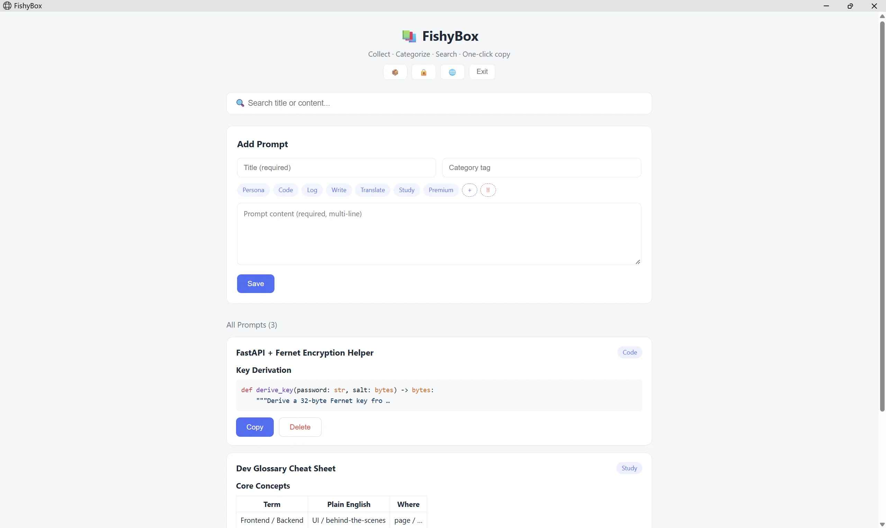
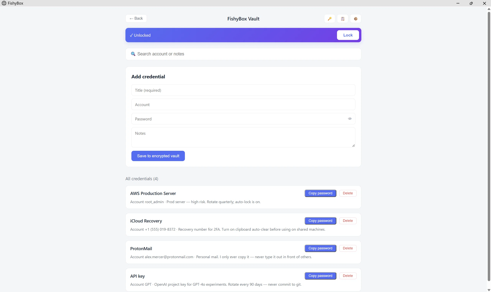
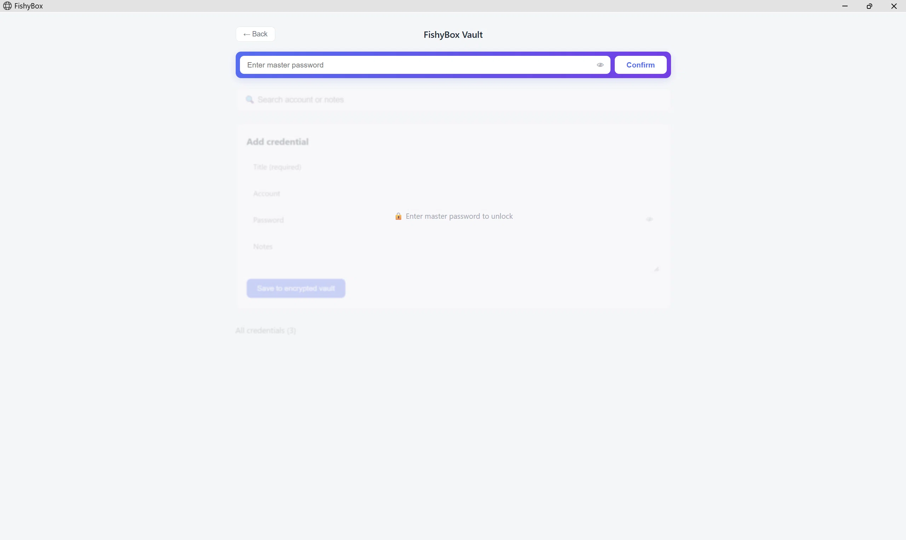
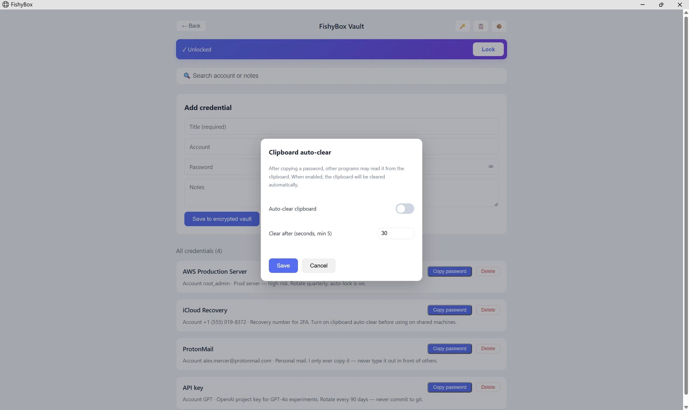

# 🐟 FishyBox

> A local-first, encrypted **Prompt asset manager** built for multitasking developers.

**English** · [简体中文](README.zh-CN.md)


---

## 💡 Why FishyBox?

Most existing tools fall into two unsatisfying extremes:

- **Full-featured password managers (e.g., 1Password)** — secure by design, but clumsy for organizing and rendering AI prompts with code blocks, tables, and formatting.
- **General note-taking apps (e.g., Obsidian)** — great for writing, but lack built-in local encryption for credentials and require heavy plugin setup.

**FishyBox is a geek-friendly hybrid:** a locally-encrypted vault *plus* a dedicated prompt asset library. It runs straight out of the zip — no installation, no account, no cloud baggage.

Unlike bloated full-screen apps, **FishyBox is built to live in a compact side window** — pin it next to your IDE, AI chat, or docs, and switch between coding and prompt lookup without breaking your flow.

---

## 📸 Screenshots

| Main interface | Encrypted vault |
|---|---|
|  |  |

| Locked state | Clipboard settings |
|---|---|
|  |  |

---

## ✨ Features

| Feature | Description |
|---|---|
| 🪟 **Standalone App Window** | A clean, frameless window — no tabs, no address bar. Pin it next to VS Code or an AI chat and switch between coding and prompt lookup without leaving your flow. |
| 📝 **Full Markdown Support** | Instant rendering of tables, code blocks, lists, and syntax highlighting. |
| 🏷️ **Tag System** | Custom tags, drag-to-reorder, one-click fill. |
| 🔐 **Encrypted Vault** | Per-field encryption, master password, auto-lock on idle. |
| 📋 **Smart Clipboard** | Optional auto-clear after copying a password (off by default, configurable countdown). |
| 🌐 **Bilingual UI** | English & Chinese, auto-detected from the browser. |
| 💾 **Flexible Backup** | Export prompts as Markdown, encrypted vault backup, or one-click full database backup. |

---

## 🚀 Quick Start

1. Download `FishyBox-v1.0.zip` from [Releases](../../releases).
2. Extract it to any folder (avoid `C:\Program Files` to prevent permission issues).
3. Double-click **`FishyBox.bat`** to launch.

> **Note:** Windows Defender SmartScreen may warn about unsigned executables (code-signing certificates are expensive for indie devs). Click **More info → Run anyway** to continue, or build from source.

All data lives in `database/` next to the executable; manual backups go to `backup/`.

---

## 💻 Local Development

```bash
# 1. Clone the repository
git clone https://github.com/Shenfengyuan08/FishyBox.git
cd FishyBox

# 2. Install dependencies
pip install -r requirements.txt

# 3. Start the app (server + window)
python launcher.py
```

---

## 🛠️ Tech Stack

- **Backend**: FastAPI + SQLite (stdlib `sqlite3`)
- **Frontend**: vanilla HTML/CSS/JS — single file, zero build step
- **Packaging**: PyInstaller (onedir mode for stability)
- **Window Shell**: Microsoft Edge `--app` mode with an isolated user profile

---

## 🧠 AI-Assisted Development

This project was built through a structured **multi-AI workflow** — not a single prompt-and-copy session.

**Workflow**

1. **Spec** — the developer defines the goal, constraints, and acceptance criteria.
2. **Multi-AI review** — four different AI models independently audit the code, UI, security, and documentation.
3. **Arbitration** — the developer compares their findings, rejects incorrect suggestions, and decides what to accept.
4. **Final review** — the strongest model runs a final consistency pass before release.

**Roles**

- **Human developer** — product architecture, UI interaction design, security strategy, feature acceptance, and prompt engineering.
- **AI assistants** — implementation, debugging, and independent review.

> Across ~15 hours of development, the developer caught **numerous AI mistakes** — broken HTML, incorrect API usage, and over-claims in the docs. The AI wrote the code; the human caught the errors.

> *Every architectural decision, security trade-off, and UI flow in this project was made by the human developer — the AI wrote the code, but the product is human-designed.*

---

## 🛡️ Security Design & Boundaries

### Core Security Mechanism

- **PBKDF2-HMAC-SHA256** with 600,000 iterations → 32-byte key.
- **Fernet** (AES-128-CBC + HMAC-SHA256) applied per field for granular encryption.
- **In-memory key only** — never written to disk, destroyed when the process exits.
- **Sentinel verification** — validates the master password without storing it.
- **Auto-lock** after 5 minutes of inactivity.
- **Clipboard auto-clear** (optional, disabled by default).

> Secrets are never rendered in plaintext on screen — they are only copied to your clipboard on demand.

**Security level: personal-developer grade.** FishyBox is strong against casual access, disk theft, and shoulder-surfing on a trusted machine. It is **not** a substitute for an audited enterprise password manager, and it is **not** designed for high-value assets or regulated data.

### ⚠️ Disclaimer

While this project follows OWASP-recommended encryption practices, please be aware of its limits:

1. **No password recovery** — if you forget your master password, the encrypted data cannot be recovered. There is no backdoor.
2. **No OS-level protection** — this software cannot defend against system-level malware, keyloggers, or screen capture tools.
3. **Backup responsibility** — pure local storage carries disk-failure risk. Regular backups via the built-in export tool are strongly recommended.
4. **No third-party audit** — this project has not undergone an independent security audit.
5. **Use-case scope** — designed for **personal developer use**. **Do NOT store high-value assets (e.g., crypto wallets, banking credentials with large balances), enterprise/company secrets, or any classified information.** The developer assumes no liability for data loss or misuse.

---

## 🗺️ Roadmap

- [ ] Split `database/prompts.db` into separate `main.db` and `vault.db` files.
- [ ] Full-text search powered by SQLite FTS5.
- [ ] Prompt version history.
- [ ] Semantic search with local embeddings.

---

## 🤝 Contributing

Issues and pull requests are always welcome!

1. Fork the repository
2. Create your feature branch (`git checkout -b feature/AmazingFeature`)
3. Commit your changes (`git commit -m 'Add some AmazingFeature'`)
4. Push to the branch (`git push origin feature/AmazingFeature`)
5. Open a Pull Request

---

## 📄 License

Distributed under the MIT License. See [LICENSE](LICENSE) for more information.
