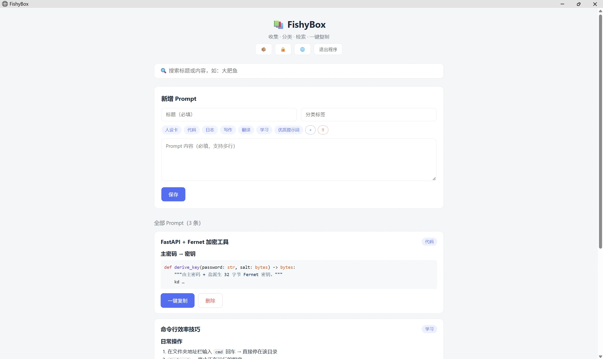
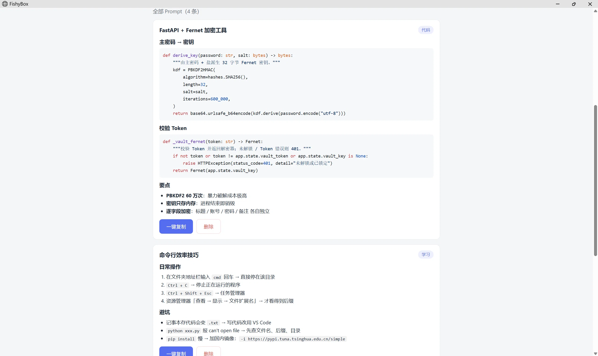
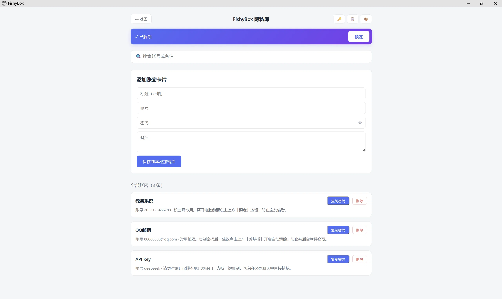
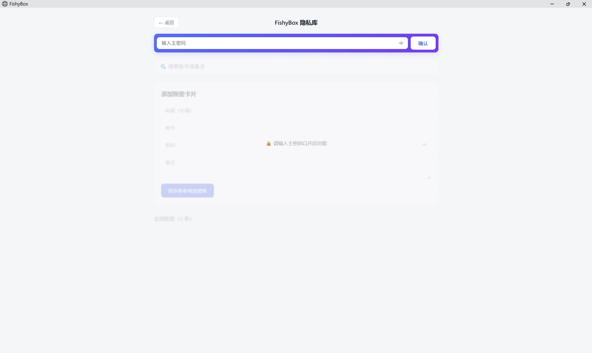

# 🐟 FishyBox

> 本地优先、加密存储的 **Prompt 资产管理器**，专为爱开一堆窗口的开发者打造。

[English](README.md) · **简体中文**


---

## 💡 为什么是 FishyBox？

市面上的工具基本分成两派：

- **专业密码管理器（1Password 这类）** —— 安全是够安全，但让它渲染带代码块、带表格的 Prompt，怎么看怎么别扭；
- **通用笔记软件（Obsidian 这类）** —— 写东西很自由，但内置没有加密，想存个密码还得装一堆插件。

**FishyBox 想走中间这条路**：一个能加密的保险柜，加一个专门管 Prompt 的库，两件事一起做。解压就能用，不装、不注册、不上云。

窗口也特意做得窄：贴在 VS Code 或 AI 聊天窗口旁边，写代码和翻 Prompt 之间，不用来回切全屏。

---

## 📸 截图

| 主界面 | Markdown 渲染 |
|---|---|
|  |  |

| 加密隐私库 | 锁屏状态 |
|---|---|
|  |  |

---

## ✨ 功能

| 功能 | 说明 |
|---|---|
| 🪟 **独立窗口** | 没有标签页、没有地址栏。挪到屏幕边上，和编辑器并排用。 |
| 📝 **完整 Markdown** | 表格、代码块、列表、语法高亮，存进去什么样，看就是什么样。 |
| 🏷️ **标签系统** | 自定义标签，拖着排序，点一下就填进分类框。 |
| 🔐 **加密隐私库** | 逐字段加密，主密码保护，闲置自动锁。 |
| 📋 **智能剪贴板** | 复制密码后可自动清空（默认关，时间可调）。 |
| 🌐 **中英双语** | 按浏览器语言自动切。 |
| 💾 **多种备份** | Prompt 导出 Markdown、隐私库加密备份、整库一键备份。 |

---

## 🚀 快速开始

1. 到 [Releases](../../releases) 下载 `FishyBox-v1.0.zip`；
2. 解压到任意文件夹（**别放** `C:\Program Files`，会有权限问题）；
3. 双击 **`FishyBox.bat`**。

> **提示**：程序没有签名，Windows Defender 可能拦一下。点 **更多信息 → 仍要运行** 就行，或者自己从源码编译。

数据都在程序旁边的 `database/` 文件夹里，手动备份放 `backup/`。

---

## 💻 本地开发

```bash
# 1. 克隆仓库
git clone https://github.com/Shenfengyuan08/FishyBox.git
cd FishyBox

# 2. 安装依赖
pip install -r requirements.txt

# 3. 启动（服务 + 窗口）
python launcher.py
```

---

## 🛠️ 技术栈

- **后端**：FastAPI + SQLite（标准库 `sqlite3`）
- **前端**：原生 HTML/CSS/JS，单文件，零构建
- **打包**：PyInstaller（文件夹模式，更稳）
- **窗口**：Microsoft Edge 的 `--app` 模式 + 独立配置目录

---

## 🧠 AI 辅助开发

这个项目不是"把提示词扔给 AI，然后复制粘贴"做出来的。流程是这样的：

1. **定规格** —— 我先定目标、约束和验收标准；
2. **多 AI 审计** —— 4 个不同的大模型分别审代码、UI、安全和文档；
3. **仲裁** —— 我自己对比各家意见，**错的直接否**，决定采纳哪些；
4. **定稿** —— 最后交给最强的模型做一遍一致性检查。

分工上：

- **我**：产品架构、交互设计、安全策略、功能验收、Prompt 工程；
- **AI**：写实现、调试、独立审计。

> 这 15 个小时里，我**挑出了不少 AI 的错** —— 从 HTML 语法错误、API 误用，到文档里的夸大表述。**AI 写代码，人抓错误。**

---

## 🛡️ 安全设计与边界

### 核心机制

- **PBKDF2-HMAC-SHA256**，60 万次迭代 → 32 字节密钥；
- **Fernet**（AES-128-CBC + HMAC-SHA256）逐字段加密；
- **密钥只在内存** —— 不写盘，进程退出就没了；
- **哨兵校验** —— 不存主密码也能验对错；
- **闲置 5 分钟自动锁**；
- **剪贴板自动清空**（可选，默认关）。

> 明文密码不会出现在屏幕上，只在你点「复制」的那一刻进剪贴板。

**安全等级：个人开发者级。** 它挡得住"随便翻看、硬盘被偷、身后有人瞄"，但**不是**经过审计的企业级密码管理器，**也不该**用来存高价值资产或受监管的数据。

### ⚠️ 免责声明

项目遵循 OWASP 推荐的加密实践，但下面的边界请认清楚：

1. **没有密码找回** —— 主密码忘了，数据就是回不来，没有后门；
2. **没有系统级防护** —— 木马、键盘记录器、屏幕录制，它挡不住；
3. **备份自己管** —— 纯本地存储，硬盘坏了就坏了，建议定期用内置导出功能备份；
4. **没做第三方审计** —— 本项目未经独立安全审计；
5. **使用范围** —— 面向**个人开发者**。**别拿来存高价值资产（比如加密钱包、大额银行凭证）、企业机密或国家机密。** 数据丢失或滥用，开发者不承担责任。

---

## 🗺️ 路线图

- [ ] 把 `database/prompts.db` 拆成 `main.db` 和 `vault.db`；
- [ ] 基于 SQLite FTS5 的全文搜索；
- [ ] Prompt 版本历史；
- [ ] 基于本地 embedding 的语义搜索。

---

## 🤝 参与贡献

欢迎提 Issue 和 PR。

1. Fork 本仓库
2. 建分支（`git checkout -b feature/AmazingFeature`）
3. 提交改动（`git commit -m 'Add some AmazingFeature'`）
4. 推上去（`git push origin feature/AmazingFeature`）
5. 发 Pull Request

---

## 📄 开源协议

基于 MIT 协议发布，详见 [LICENSE](LICENSE)。
